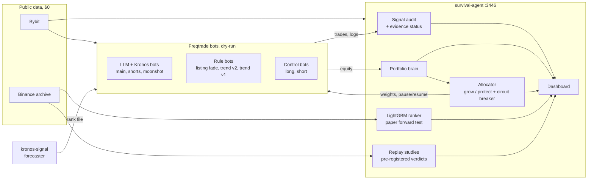

# Survival Agent

[](./LICENSE)


**A paper-trading crypto lab that is more interested in disproving its own trading ideas than in making them look good.**

Eight simulated bots (LLM-driven, forecasting-model-driven, rule-based, plus two do-nothing control groups) trade on Bybit through
[Freqtrade](https://www.freqtrade.io) in `dry_run`, supervised by a FastAPI service that **measures whether any of it works**, controls portfolio risk and
refuses to call anything "an edge" without statistics. No real order is ever placed.

> **Not financial advice. Nothing here has been shown to make money.** Every result below is a backtest or a paper-trading number, and most of them are negative.
> That is the point of the project: *claiming* an edge is easy, *proving* one is the work, so most of this repository is the machinery for proving or disproving it.

## Contents

[Results at a glance](#results-at-a-glance) · [What is running](#what-is-running) · [How the pieces fit](#how-the-pieces-fit) · [Running it](#running-it) ·
[Verifying it yourself](#verifying-it-yourself) · [Repository layout](#repository-layout) · [Honest status](#honest-status) · [Before you expose or reuse this](#before-you-expose-or-reuse-this)

| Document | What it is |
|---|---|
| [HOW_IT_WORKS.md](./HOW_IT_WORKS.md) | the idea and one trading cycle, step by step, with the full LLM prompts |
| [ARCHITECTURE.md](./ARCHITECTURE.md) | components, data flow, volumes, trust boundaries, extension points |
| [ENVIRONMENT_VARIABLES.md](./ENVIRONMENT_VARIABLES.md) + [.env.example](./.env.example) | every setting, with defaults; the `.env.example` file imports straight into Portainer |
| [AGENTS.md](./AGENTS.md) | the engineering journal: every change, why, how it was verified, and what is **not** verified |
| [SECURITY.md](./SECURITY.md) · [CONTRIBUTING.md](./CONTRIBUTING.md) | how to run it safely, how to change it |
| [backtest/results/](./backtest/results) | the reports of every study quoted here |

## Results at a glance

Every study is **pre-registered**: the rules and the pass thresholds are written down before the run, the verdict is computed by code
(`edge candidate` / `unproven` / `no edge` / `insufficient n`), there is a locked period for looking and a later out-of-sample period that decides, costs are real, and a placebo
(random coins or shuffled labels) must be beaten. All of them cost $0 (public data, CPU only) and are runnable from the **Replay** page.

| Idea | Data | Result |
|---|---|---|
| Funding carry (long spot / short perpetual) | Bybit, 2.7 years | compressed to about 1% a year; not worth trading at this size |
| Shorting coins after a delisting notice | 217 Bybit perpetuals | `no edge` (mean +0.24%, median −3.2%, 99 of 217 hit the stop) |
| Cross-sectional momentum, top 20 perpetuals | Bybit, 2.7 years | `unproven` (CI includes 0, 44% drawdown, sign flips with the lookback) |
| Kronos-small forecaster as an entry signal | 14,400 hourly forecasts, 20 pairs | `no edge`; rank IC about 0.02 at 4 h and 0 at 24 h; strongly bearish bias |
| Listing Fade (rule bot) | every Bybit listing since 2024 | break-even at realistic costs; a tighter stop is **worse**; a re-entry cooldown helps a little; its unfilled limit entries are its winners |
| LightGBM cross-sectional ranker v1 | Bybit daily, top 20 | `unproven` |
| **LightGBM ranker v2** | **Binance, 899 contracts, hourly features, 2021 to 2026** | `unproven`, and the **closest to a lead**: out-of-sample APR 99% (CI 34% to 169%), rank IC 0.069, beats a shuffled-label placebo, positive at 0.30% slippage and with returns clipped at ±50%, IC positive in 12 of 12 neighbouring settings; **but a 54% drawdown**, so it is not tradeable as built. A forward paper test is built in (below) |
| Premium-index features added to the ranker | Binance archive | no gain (IC −0.0007): `keep v2 features` |
| Limit-order (maker) execution for the ranker | hourly price paths | `passive pays`: about +13 percentage points of APR from the fee and slippage saving, assuming fills happen when price touches the order |

What the allocator and the bots did live in dry-run is covered in [Honest status](#honest-status). The LLM and rule bots show **no measurable entry edge**; their results are
dominated by the shape of their exits (many small wins, a few large stops).

## What is running


| Container | Port | What it is |
|---|---|---|
| `survival-agent` | **3446** | FastAPI backend + dashboard: accounting, portfolio brain, signal audit, market-context collector, allocator, export centre, switches |
| `freqtrade` (main) | 8099 | entry decision: LLM and / or Kronos, spot, long only (see "Decision source" below) |
| `freqtrade-shorts` | 8110 | entry decision: LLM and / or Kronos, futures 1x, long / short |
| `freqtrade-moonshot` | 8120 | entry decision: LLM and / or Kronos, small / newly listed coins |
| `freqtrade-listing-fade` | 8160 | rule-based, shorts fizzled pumps after a listing |
| `freqtrade-trend-ensemble` | 8170 | rule-based Donchian trend (v1), frozen, not managed |
| `freqtrade-trend-v2` | 8200 | rule-based trend v2, long + short, BTC regime filter. **Backtest did not confirm it** (see AGENTS.md); dry-run only |
| `freqtrade-control-long` / `-short` | 8180 / 8190 | **control group**: Freqtrade's own sample strategy. Never managed, never given data, the yardstick for everything else |
| `kronos-signal` | none | CPU-only hourly forecaster ([Kronos](https://github.com/shiyu-coder/Kronos), `Kronos-small`); writes a *signal* and a per-bot cross-sectional rank, never trades |
| `kronos-replay` | none | CPU-only worker that makes *historical* Kronos signals for the `/replay` page; idle until a job exists; weights baked into the image |

Exits are never decided by an LLM or by Kronos: Freqtrade's own `minimal_roi` / `stoploss` / trailing rules do that (plus the strategies' own rotation rule).

### Decision source and LLM provider (Main, Shorts, Moonshot)

Each of the three entry-driven bots has two switches (Portainer environment variables, per bot: `MAIN_`, `SHORTS_`, `MOONSHOT_`; every value is validated, an invalid one falls back to the default):

| Variable | Values | Meaning |
|---|---|---|
| `<BOT>_DECISION_SOURCE` | `llm` / `kronos_llm` (compose default) / `kronos` | `llm`: the LLM decides, as before. `kronos_llm`: Kronos proposes a direction from its cross-sectional 24h forecast, the LLM may only **confirm or veto** it (code enforces it: any other answer is a veto). `kronos`: Kronos alone decides, no LLM call. |
| `<BOT>_LLM_PROVIDER` | `deepseek` (default) / `free` / `none` | `deepseek`: DeepSeek, OpenRouter as fallback. `free`: OpenRouter **free models only** (never DeepSeek, never a paid model). `none`: the LLM is never called; with source `llm` the bot is intentionally idle (leave it empty), with `kronos_llm` it behaves as `kronos`. |

A missing, old (> ~2 h) or malformed Kronos signal for a pair is **hold** (fail-safe; there is no fallback to the LLM). Kronos feeds the bots through a read-only copy on the shared allocator volume (`kronos_rank.json`, published by survival-agent every 2 minutes from the kronos container's own volume).
**Honest status:** on 15 days of historical forecasts Kronos showed no net edge (`no edge`, see `backtest/results/p22_kronos_eval_partial_15d.md`); only the 24h rank correlation looked positive (IC +0.10, but the first half was indistinguishable from 0 and the top-third / bottom-third spread was zero). The switches exist so that this can be measured live in dry-run, not because an edge was found.

## How the pieces fit

```
 Bybit (public + dry-run)           bots' REST (GET, + pause/resume for 5 of them)
        │                                         │
  ┌─────▼──────────────┐   hourly   ┌─────────────▼───────────────────────────────────────────┐
  │ market_context     │──snapshot─▶│ survival-agent                                          │
  │ funding, OI, L/S,  │            │  signal_audit  parses every LLM decision from the bots'  │
  │ macro calendar,    │            │                logs (+ kronos file) into an append-only  │
  │ news states, F&G   │            │                ledger, scores forward returns 1/4/24h    │
  └────────────────────┘            │  portfolio_brain  daily: equity, HWM, CPPI budget,       │
  ┌────────────────────┐            │                drawdown ladder, evidence status per bot  │
  │ kronos-signal      │──signals──▶│  allocator     daily + on events: an LLM proposes a      │
  │ (own container)    │  (volume)  │                weight per bot, hard rules in code veto it │
  └────────────────────┘            │  export centre ZIP of logs, trades, aggregates, ledger   │
                                    └───────┬──────────────────────────────┬──────────────────┘
                                            │ /allocator volume (ro)       │ REST: /stopentry, /start
                                   context + weights read by the bots      ▼
                                   (prompt block, stake multiplier)    the 5 managed bots
```



### The measurement layer (the point of the project)

- **Control group (P17-C).** Two bots run Freqtrade's sample strategy. Every bot is compared with the control of its market type and with BTC buy-and-hold.
- **Signal ledger and audit (P19).** Each LLM `buy` / `sell_short` / `hold` per pair per candle is recorded (parsed from the bot's own log, no strategy change),
  with the price at the decision. A nightly job computes the forward return at 1h / 4h / 24h from candles **after** the decision only, subtracts the
  cross-sectional mean of all pairs scanned at the same moment, and reports per bot and direction: n, hit rate, mean excess, a **bootstrap 95% CI**, and the rank
  correlation of confidence with the outcome. Below 100 actions in a direction the answer is "not enough data". Slices by market-context flags (funding extreme, OI spike,
  macro event) tell which data source helps and which is noise. A test mutates candles around the decision time to prove there is no look-ahead.
- **Evidence status (P19).** Each bot gets one label from its closed trades *after fees*: `no_data`, `no_edge`, `unproven`, `edge`. `edge` requires the CI lower bound above zero **and**
  beating its control **and** BTC hold. A cost gate flags bots whose fees exceed half of their gross P&L. Criteria for live money are written into the report, not into code; today no bot passes.
- **Kronos as a free signal (P20.4-B).** A foundation model forecasts the next 24 hourly candles of the ~25 most liquid pairs; the signal enters the same ledger
  as another "bot" and is scored the same way. First conclusions only after 200 signals per direction and 14 days, and only if the CI lower bound is above zero
  at 4h or 24h in *both halves* of the period.

### The control layer (P17-A, P20)

- **Portfolio brain.** Daily at 00:10 UTC: equity, high-water mark, CPPI risk budget (`3 x (equity - 90% floor)`), gross / net exposure, opposite positions across bots,
  the drawdown ladder (-3 / -6 / -8%, weekly -2%, monthly -4%). Read-only.
- **Market context (P20-A).** Hourly snapshot of Bybit derivatives, a macro calendar, news (three distinct states: `no_news`, `feed_down`, `news_found`), Fear & Greed and BTC
  dominance. Every field carries `value / ts / source / status` (`ok`, `stale` after 3h, `unavailable`); derived flags are computed in code, never by the LLM. What cannot be
  fetched (liquidations, ETF flows, on-chain) is reported as unavailable, never guessed.
- **Allocator (P20-B).** An LLM proposes a weight 0..1 per managed bot (code validates the JSON; a bad reply means "no change", one retry). **Hard rules in code have the last word**:
  +-25 percentage points per day, drawdown ladder, proportional CPPI scaling (all zero only at 1.5x budget or a floor breach), macro-window cap, opposite positions, coin concentration.
  Weight 0 pauses new entries (`/stopentry`, exits keep working); a weight between 0 and 1 scales the stake through a shared read-only weights file. Every decision is one line in
  `allocations.jsonl` with the LLM reply and each rule step, and a counterfactual ("with" vs "without" the allocator, net of fees, no look-ahead) decides after four weeks
  whether it stays on. A bot at weight 0 for 7 days gets a one-day probe weight so that evidence keeps flowing.
- **Safety invariants.** Dry-run only (the allocator refuses to run in `enforce` if any active managed bot reports `dry_run=false`); control bots, `trend_ensemble` and `kronos` can never be managed
  (a code-level error, tested); retired bots are not polled and their equity is frozen as a constant so a stopped bot cannot fake a drawdown; one silent bot does not zero the budget;
  incomplete data only warns; a kill switch on the dashboard returns to shadow, resumes the bots it paused and resets all weights to 1.
- **Modes.** `PORTFOLIO_BRAIN_MODE = off | shadow | enforce`. `shadow` computes and logs everything and touches nothing. All switches are also on the dashboard, with their source
  (UI / environment / default) and an audit log.

**Allocator policy.** `grow` (default) raises bots that earn money, stops bots that lose and restarts them with a 0.5x trial when their control bot made money, and only scales the whole book down on a real drawdown, never idling it; `protect` is the original loss-rule set. `ALLOCATOR_POLICY` / dashboard switch; a run that finds a live bot automatically uses `protect`. Details in `ENVIRONMENT_VARIABLES.md`. A **circuit breaker** stops a bot that loses more than 1.25 average stakes (or 8 losing trades in a row) after at least 5 trades, without waiting for the 30-trade verdict; the Listing Fade bot has a **re-entry cooldown** (24 h after a stop-loss, a dashboard switch). Both are on the Portfolio tab; the question whether a tighter Fade stop would also help is a pre-registered study on the Replay page.

**LightGBM ranker (paper only).** `RANKER_MODE=shadow` runs the walk-forward study's LightGBM model forward on paper: every day it ranks the top-40 Binance perpetuals, keeps a plain and a volatility-scaled paper book (long top 8 / short bottom 8, 3-day hold), scores each ranking against what really happened and computes a pre-registered forward verdict (`collecting` for 8 weeks, then `forward pass` / `unproven` / `failing`). It never places an order or touches a bot. Dashboard: Portfolio tab -> LightGBM ranker. Off by default; the first start downloads about 0.5 GB of public history.

**Settings in one place.** `.env.example` is a complete import file for Portainer (every variable of `docker-compose.yml`, grouped, with defaults); `ENVIRONMENT_VARIABLES.md` explains each one, including the decision-source variants (`llm` / `kronos_llm` / `kronos`) per bot.

### Announcement guard and the funding carry study (P25)

**Announcement guard (live, a rule, not an LLM).** Every 10 minutes the backend reads Bybit's delisting notices (perpetual contracts: exact symbols and delisting time; token lists), keeps every notice in a ledger and publishes `blocked_pairs.json` on the shared volume. Main, Shorts, Moonshot, Listing Fade and Trend v2 refuse a **new** entry on a coin with a notice in force (`confirm_trade_entry`); exits and open trades are untouched; a missing or stale file blocks nothing (fail-open). The controls and Trend v1 are left alone. Measured on the first three weeks of live trades: 0 of 567 trades opened inside a notice window, so today it is insurance, not profit (the median notice comes 2 days before the delisting).

**Funding carry study (`/replay`, Studies tab, $0).** Long spot / short perpetual on Bybit, replayed on public history since 2024 with real fees, funding, basis and slippage, a pre-registered verdict and an out-of-sample split. First real result (2026-10-12): with the spot leg required, +$571 on a $3,000 sleeve over 2.7 years but only +$40 out-of-sample (since 2025-07): the carry has compressed to about 1% a year; BTC/ETH-only is about 0 (funding now 1.7% / -0.4% a year). The unconstrained run (+$1,232) is not realisable: its biggest earners have no spot market. Verdict: not worth trading at this size today. Report: `backtest/results/p25_carry_study_real.md`.

**Two more studies on /replay (P25, $0, 2026-10-12).** *Delisting shorts:* shorting 217 Bybit perpetuals after their delisting notice (1 h reaction delay) averaged +0.24% per trade after costs with a median of -3.2%; 99 of 217 hit the +10% stop; no edge. *Cross-sectional momentum* on the top 20 perpetuals: 42% a year over 2.7 years and 55% out of sample, but a confidence interval that includes 0, a 44% drawdown and a sign that flips between 14- and 28-day lookbacks: unproven. Reports in `backtest/results/`.

### The interface (P24)

Three pages share one look and one header. **Dashboard** (`/`) is centred on the bots: *Overview* (portfolio, scorecard), *Bots* (one page per bot: strategy, live parameters read from the running bot, decision-source switch and its environment variable names, status and money, evidence, max open trades, per-bot downloads; trading mode on Main), *Portfolio* (goal and payout, daily balance history, portfolio brain, allocator), *Signals & Kronos* (the live Kronos feed and the signal audit), *Downloads* and *Settings* (environment). **Downloads** is the one place for everything downloadable: bot logs, trades and the analysis ZIP (export centre), the accounting, brain, allocator, signal and Kronos files, and every training, calibration and replay run with its report, ZIP and log; secrets are never listed. **Training & calibration** (`/calibration`) holds the live reference, the calibration and the Kronos signal work with their logs and reports. **Replay** (`/replay`) is for tests only. Everything is English, and the layout is checked at phone, tablet and desktop widths.

### Replay (P21): weeks of history in minutes, with the limits written on the page

`/replay` on :3446 (tests only; training and calibration moved to `/calibration`) runs the LLM bots' real strategy code over cached Bybit candles (as-of every candle, no look-ahead), simulates the trades with each bot's own exits, fees and slippage, and reports n, win rate, mean trade, CI, drawdown, a BTC buy-and-hold
and a random-entry baseline, plus the P19 audit on the replay decisions, each bot in two modes: named and anonymized (an edge that exists only when named is flagged as possible knowledge leakage). It is a separate page with an estimate-before-start button,
hard dollar / call limits, a disk cache (the same run twice costs nothing), a live log and a ZIP download. **It never assigns `edge`** and never touches live state; a negative result is a strong argument against a bot, a positive one is weak.

### The export centre (P18)

`GET /api/export/bundle` builds one ZIP: bot logs (secrets masked), trades, the FreqUI aggregates of every bot (`/profit`, `/daily`, `/weekly`, `/monthly`, `/performance`, `/stats`, `/entries`, `/exits`, `/balance`, ...), the brain
reports, the signal ledger and audit, the market-context snapshots and the allocator decisions and counterfactual. Port 3446 is meant for the LAN only.

## Running it

Requires Docker + Docker Compose (built for a Portainer stack deployed straight from this repository).

1. Portainer: **Stacks -> Add stack -> Repository**, URL of this repository (or your fork), compose path `docker-compose.yml`. Or, with plain Docker Compose: copy `.env.example` to `.env`, fill in the secrets and run `docker compose up -d`.
2. Environment variables (Stack -> Editor -> Environment variables; the full list with defaults is in [ENVIRONMENT_VARIABLES.md](./ENVIRONMENT_VARIABLES.md)):
   - `FREQTRADE_API_USERNAME` / `FREQTRADE_API_PASSWORD` / `FREQTRADE_API_JWT_SECRET`: the login shared by every bot's REST API (the allocator and the collectors use it too).
   - `DEEPSEEK_API_KEY` (primary LLM) and `OPENROUTER_API_KEY` (fallback).
   - `PORTFOLIO_BRAIN_MODE` (`off | shadow | enforce`; the compose default is `enforce`, switchable on the dashboard), `ALLOCATOR_RETIRED_BOTS` (default none), `MARKET_CONTEXT_MODE`, `SIGNAL_AUDIT_MODE`.
   - Kronos: `KRONOS_MODE`, `KRONOS_THRESHOLD` (default 0.005 after fees), `KRONOS_MAX_PAIRS` (45), `KRONOS_SAMPLES` (3), `KRONOS_SKIP_BOTS` (none), and the per-bot `<BOT>_DECISION_SOURCE` / `<BOT>_LLM_PROVIDER` above.
   - Exchange keys (`BYBIT_*_API_KEY` / `_SECRET`) are only needed once a bot goes live; every bot has its own `*_DRY_RUN` toggle, `true` by default. **Going live is a separate, deliberate decision; nothing here does it as a side effect.**
3. The Kronos image is about 1.5-2 GB. Its Dockerfile checks the free disk **during the build itself** (nothing to run by hand): the free space is printed in the build log and the build stops only below 3 GB (`KRONOS_MIN_FREE_GB`). See [kronos-signal/](./kronos-signal/).
4. Open `http://<server-ip>:3446`. Cards: bots, thresholds, environment status, portfolio brain (evidence chips, cost gate), signal audit, allocator and market context (with the switches and the kill switch), export centre.
5. Freqtrade images are pinned (`freqtradeorg/freqtrade:2026.8`). Do not float them on `stable`: Freqtrade's database migrations only go forward.

## Verifying it yourself

Every `backtest/test_*.py` is self-contained (Python 3 with `fastapi`, `pyyaml`, `numpy`, `pandas`, `lightgbm` and the backend requirements; fake bots, fake exchanges and synthetic data; no network, no keys, no containers)
and prints `ALL ... CHECKS PASSED`. Run one, or all 42:

```bash
python backtest/test_p19_signal_audit.py          # ledger, look-ahead safety, bootstrap, per-direction gate
python backtest/test_p25_grow_policy.py           # the allocator's grow policy
python backtest/test_p26_breaker_guard_exit.py    # circuit breaker, Fade re-entry guard, exit study
python backtest/test_p26_ranker.py                # the ranker's paper forward test, books A / B / C
for t in backtest/test_*.py; do python "$t" | tail -1; done      # everything
```

The studies themselves are not tests: they run on real public data from the Replay page (or from a script) and write a report next to the verdict. The reports quoted in this README are in
[backtest/results/](./backtest/results). `backend/ops/p20_live_test.py` and `backend/ops/p20_enforce_check.py` are the two scripts that *do* need the running stack.

## Repository layout

```
survival-agent/
├── docker-compose.yml          # the whole stack: survival-agent, 8 Freqtrade bots, kronos-signal / kronos-replay, named volumes
├── backend/
│   ├── app.py                  # FastAPI: dashboard, accounting, all /api endpoints, schedulers
│   ├── export.py               # P18 export centre
│   ├── engine/
│   │   ├── portfolio_brain.py  # daily risk numbers, CPPI, ladder, evidence (read-only)
│   │   ├── signal_audit.py     # ledger + forward returns + bootstrap audit (+ kronos source)
│   │   ├── evidence.py         # statistics: bootstrap CI, Spearman, evidence status, cost gate
│   │   ├── market_context.py   # hourly snapshot with per-field status
│   │   ├── allocator.py        # LLM allocator with hard-rule veto, pause/resume, counterfactual
│   │   ├── bot_state.py        # retired / stale / unreachable bots
│   │   ├── bot_params.py       # P26: parameters pushed to the bots without a restart (Listing Fade re-entry cooldown)
│   │   ├── ranker.py           # P26: LightGBM ranker paper forward test (books A / B / C, forward verdict)
│   │   ├── announcements.py    # P25: exchange delisting notices -> blocked_pairs.json
│   │   ├── runtime_settings.py # dashboard switches (override the environment, audited)
│   │   ├── brain.py            # LLM call wrapper (DeepSeek, OpenRouter fallback)
│   │   └── (risk_guard, signals, executor, loop)  # the original dormant engine, kept for history
│   ├── replay/                 # P21: as-of candle store, strategy sandbox, LLM client (cache, budget), simulator, analysis, job runner
│   │                           #   studies (all $0, pre-registered): listing_fade, fade_exit_study, carry, delist_study, momentum, lgbm_study, lgbm_hourly,
│   │                           #   lgbm_grid, lgbm_premium, maker_study; kronos_replay / kronos_eval for the forecaster
│   └── ops/                    # p20_live_test.py, p20_enforce_check.py
├── frontend/index.html         # the dashboard (tabs: Overview, Bots, Portfolio [allocator, LightGBM ranker], Signals & Kronos, Downloads, Settings)
├── frontend/calibration.html   # Training & calibration (/calibration): live reference, calibration, Kronos signal, reports and logs
├── frontend/replay.html        # Replay (/replay): tests only; the Studies tab runs every pre-registered study
├── frontend/ui.css, nav.js     # shared look and header of the three pages
├── freqtrade*/                 # one directory per bot: Dockerfile + config + strategy (duplicated on purpose, each is built on its own)
├── kronos-signal/              # CPU-only forecaster container (pinned model revisions, sha256-checked weights)
├── backtest/                   # tests, backtests, the LLM replay and the A/B tools
├── AGENTS.md                   # the engineering journal: every change, why, how it was verified, and what is NOT verified
├── ARCHITECTURE.md, HOW_IT_WORKS.md, ENVIRONMENT_VARIABLES.md, .env.example
├── SECURITY.md, CONTRIBUTING.md, LICENSE
└── data/ (volume)              # config, ledger, snapshots, reports -- never in git
```

## Honest status

- **Everything is paper trading.** No bot has met the live-money criteria (edge status, at least 100 trades over at least 8 weeks, positive after fees, better than its control and BTC hold).
- **The bots' entries carry no measurable edge.** In four weeks of dry-run the LLM and rule bots show the same payoff shape: many small wins and a few large stops, so their win rate has to exceed 75 to 90% to break even and it does not. The no-LLM control bot loses as much as the LLM bots. Details and the numbers are in [AGENTS.md](./AGENTS.md).
- **The allocator** (`grow` policy: raise earners, stop losers, restart them through their control bot; plus a circuit breaker) protects capital; it does not create a profit source. Its usefulness is unproven by design: it must beat its own counterfactual for four weeks or it falls back to shadow by itself.
- **Kronos** is an experiment that did not pan out as an entry signal (`no edge`, rank IC about 0). It is kept switchable so it can be measured live.
- **The one lead** is the LightGBM cross-sectional ranker (see the results table). It is **not** tradeable as built (54% drawdown) and it has not yet been tested forward: `RANKER_MODE=shadow` runs that test on paper for at least 8 weeks, with a verdict computed by code.
- Trend v2 failed its own backtest gates and runs for observation only. Dip and Survival bots were removed on 07.10.2026 (their history lives in the git log).
- Known gaps are listed per change in [AGENTS.md](./AGENTS.md): for example, liquidations are not collected (Bybit offers them only over WebSocket), maker-fill results assume a fill whenever price touches the limit, and the Docker images have not been built in CI.

## Safety notes

- No credential is ever written to a file git tracks. The export masks secrets in every log line; the dashboard shows only whether a variable is set, never its value.
- The original hand-rolled engine (`signals -> brain -> risk_guard -> executor`) is dormant; `risk_guard.py` still caps position size and daily loss if it is ever switched on.
- An LLM never places an order, never sets a stop and never changes a threshold. It proposes; Freqtrade's rules and the hard rules in code decide.

## Before you expose or reuse this

- **Dry-run only, by design.** Nothing in the app can switch a bot to real money: `/api/live-trading` only records an intent; the real switch is the Freqtrade environment in your container platform. Do not change that casually.
- **No authentication in the survival-agent web app.** It is meant for a private network. Anyone who can reach port 3446 can change thresholds, pause bots through the allocator, and start paid LLM replays (capped by `REPLAY_MAX_USD`). **Never publish this port to the internet**; put it behind a VPN or an authenticating reverse proxy.
- Secrets live only in your container platform's environment (and `data/.env` on the host, git-ignored). The `config.json` files contain placeholders (`set-via-credentials-panel`) and an empty CORS list: set `FREQTRADE_UI_HOST` (the host name or IP you open the bot UIs with) so FreqUI can switch between bots.
- Nothing here is financial advice. See `LICENSE` (MIT) for the warranty disclaimer.
- Read [SECURITY.md](./SECURITY.md) before you deploy: it lists what the dashboard can do to your bots, how to put it behind a VPN or an authenticating proxy, and how to report a problem.

## Licence

MIT, see [LICENSE](./LICENSE). Third-party components keep their own licences: the Kronos code and weights (MIT, see `kronos-signal/NOTICE.md`), the Freqtrade images (GPL-3.0, used as an unmodified container image and not included here), public exchange data.
